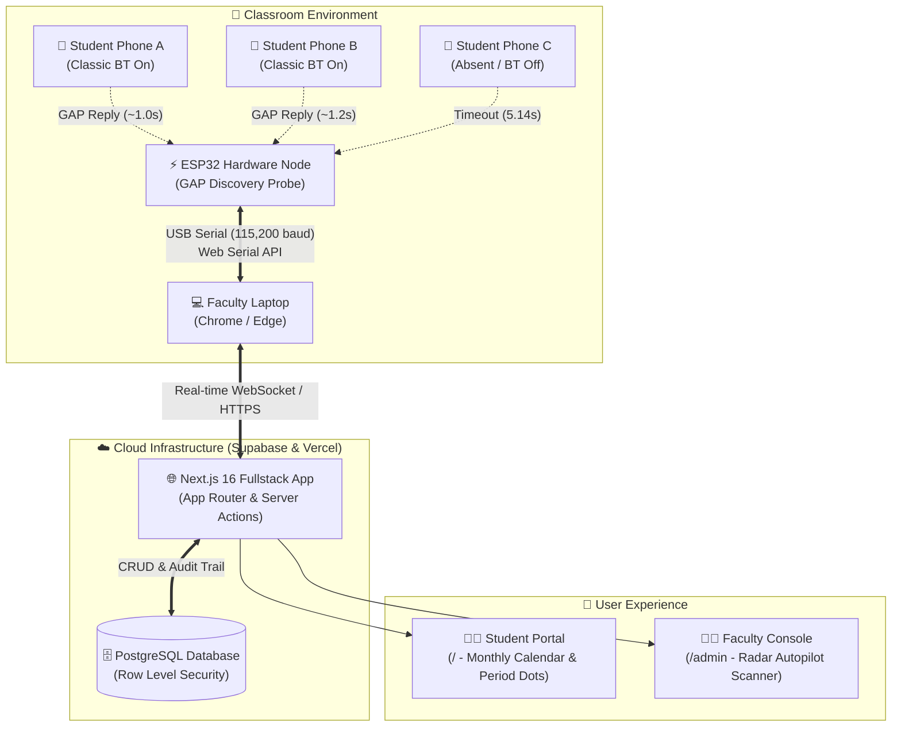

# 🎓 Smart Attendance System

[](https://nextjs.org/)
[](https://www.typescriptlang.org/)
[](https://tailwindcss.com/)
[](https://supabase.com/)
[](https://www.espressif.com/)
[](https://opensource.org/licenses/MIT)

> **Automated, non-invasive classroom attendance powered by ESP32 Classic Bluetooth radio probing and a modern Next.js cloud console.**

---

## 📌 Executive Summary

Traditional classroom attendance methods introduce friction, proxy attendance, and wasted lecture time:
- **Paper Roll Calls**: Consume 10–15% of class time and allow verbal proxy call-outs.
- **Biometric Scanners**: Create bottleneck queues at the classroom door and pose hygiene concerns.
- **QR Codes / Captive Portals**: Can be screenshotted and shared over WhatsApp with absent peers.

The **Smart Attendance System** eliminates all of these problems through **Zero-Touch Classic Bluetooth Probing**. Students need **no mobile application**, **no Bluetooth pairing**, and **no location permissions**. Leaving standard Bluetooth enabled in phone settings allows the classroom node to verify their presence in the background.

---

## 🏗️ System Architecture



---

## 🚀 Key Features

### 👨‍🎓 1. Student Portal (`/`)
- **Frictionless Lookup**: Students enter only their College Registration Number (e.g. `CCE25CS031`).
- **Period-by-Period Calendar**: Visual dots for every class session indicating status (*Present*, *Under Review*, or *Absent*).
- **Discrepancy Reporting**: Built-in dialog to flag attendance discrepancies directly to faculty.
- **Privacy & Confidentiality**: Bluetooth MAC addresses are encrypted and strictly hidden from student-facing views.

### 👨‍🏫 2. Faculty & Admin Console (`/admin`)
- **Autopilot Radar Scanner (`/admin/run`)**:
  - Live animated radar visualizer powered by the **Web Serial API**.
  - Real-time terminal output, hardware latency metrics, and probe attempt counters.
- **Timetable & Window Feasibility Planner (`/admin/timetable`)**:
  - Mathematical window budget solver that verifies whether class cohorts can be probed within period duration constraints.
- **Student Directory & Drawer (`/admin/students`)**:
  - Interactive telemetry drawer showing overall attendance rate, historical sessions, and inline overrides.
- **Day Matrix View (`/admin/calendar/[date]`)**:
  - Period-by-student grid with past-midnight lock rules.
- **Tamper-Evident Audit Trail (`/admin/audit`)**:
  - Every automated scan and manual override is logged with timestamps, actors, and reasons.
- **Theme Switcher**:
  - Full support for High-Contrast Light Mode and Neutral Charcoal Grey (`zinc`) Dark Mode.

---

## ⚡ Physics & Timing Model

The scanning engine leverages deterministic Classic Bluetooth Generic Access Profile (GAP) discovery physics:

| Event | Latency | Outcome | Description |
| :--- | :--- | :--- | :--- |
| **Phone Present (BT ON)** | `~1.0 s` | **Present** | Immediate GAP name discovery reply |
| **Phone Absent (BT OFF)** | `5.14 ± 0.4 s` | **Absent** | Hardware timeout benchmark |
| **Fast False-Absent Glitch**| `< 1.0 s` | **Auto-Retry** | ESP32 automatically retries once to guarantee accuracy |

---

## 📂 Repository Layout

```
.
├── .github/
│   └── workflows/
│       └── ci.yml             # GitHub Actions CI (Type Check + Tests + Build)
├── edis-web/                  # Next.js 16 Web Application
│   ├── app/                   # App Router pages and API routes
│   │   ├── admin/             # Faculty console (Radar, Calendar, Students, Audit)
│   │   ├── api/               # Server-side API handlers (Lookup, Report, Cron)
│   │   └── page.tsx           # Student public lookup portal
│   ├── components/            # Reusable UI component library & modals
│   ├── contexts/              # React Context providers (ThemeContext)
│   ├── lib/                   # Window planner, serial adapter, color logic & unit tests
│   ├── public/                # Static assets, branding, and icons
│   └── .env.example           # Sanitized environment variable template
├── esp32-firmware/            # Microcontroller C++ / Arduino Source
│   ├── bt_attendance_node.ino # Classic Bluetooth GAP discovery engine
│   └── README.md              # Firmware flashing & pinout documentation
├── supabase/
│   └── schema.sql             # Complete PostgreSQL schema & RLS policies
├── .gitignore                 # Bulletproof gitignore protecting secrets
├── LICENSE                    # MIT License
└── README.md                  # Project documentation
```

---

## 🛠️ Getting Started

### 1. Prerequisites
- **Node.js**: v18.18+ (tested on Node v20 and v24)
- **Browser**: Google Chrome or Microsoft Edge (required for Web Serial API support)
- **Hardware**: ESP32 DevKit V1 (or equivalent ESP32 board with Classic BT support)

---

### 2. Database Setup (Supabase)
1. Create a new project on [Supabase](https://supabase.com).
2. Open the **SQL Editor** in your Supabase dashboard.
3. Paste and run the contents of [`supabase/schema.sql`](supabase/schema.sql).
4. Retrieve your **Project URL**, **Anon Key**, and **Service Role Key** from `Project Settings > API`.

---

### 3. Web Application Setup
1. Navigate to the web application directory:
   ```bash
   cd edis-web
   ```
2. Install dependencies:
   ```bash
   npm install
   ```
3. Configure environment variables:
   ```bash
   cp .env.example .env.local
   ```
   Open `.env.local` and configure your Supabase credentials:
   ```env
   NEXT_PUBLIC_SUPABASE_URL=https://your-project.supabase.co
   NEXT_PUBLIC_SUPABASE_ANON_KEY=your-anon-key
   SUPABASE_SERVICE_ROLE_KEY=your-service-role-key
   NEXT_PUBLIC_SERIAL_ADAPTER=real    # Use "mock" for browser testing without hardware
   NEXT_PUBLIC_SERIAL_BAUD_RATE=115200
   ```
4. Start the development server:
   ```bash
   npm run dev
   ```
   Open [http://localhost:3000](http://localhost:3000) in Google Chrome or Microsoft Edge.

---

### 4. Running the Test Suite
The project includes 49 unit tests verifying the mathematical window scheduler, worst-case latency calculations, status resolution rules, and date arithmetic:
```bash
cd edis-web
npm test
```

To compile for production:
```bash
cd edis-web
npm run build
```

---

### 5. Flashing the ESP32 Firmware
Refer to the dedicated [`esp32-firmware/README.md`](esp32-firmware/README.md) for step-by-step flashing instructions using the Arduino IDE.

---

## 🔒 Security & Privacy

- **Confidentiality**: Bluetooth MAC addresses are hardware identifiers; they are kept strictly on the backend and are never displayed on the student portal.
- **Row Level Security (RLS)**: PostgreSQL tables are protected with strict RLS policies, ensuring student lookups only execute through secure server-side procedures.
- **Tamper-Evident Auditing**: Attendance overrides cannot be altered silently; every change records actor identification, previous state, new state, and mandatory administrative reasons.
- **Session Protection**: Administrative credential modifications automatically invalidate active sessions, enforcing re-authentication.

---

## 📄 License

This project is licensed under the MIT License — see the [LICENSE](LICENSE) file for details.
